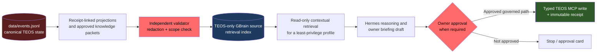

# GStack and GBrain Deep Assessment for Tender Export OS

**Assessment timestamp:** 2026-08-10T08:32:02Z  
**Scope:** read-only inspection of the live local installation, Tender Export OS configuration, and upstream official documentation.  
**Not performed:** installation, upgrade, sync, reindex, MCP registration, browser-cookie import, service restart, autopilot change, or external action.

**Companion report:** `docs/GSTACK_GBRAIN_GOVERNED_TEOS_ASSESSMENT.md` maps official GStack/GBrain documentation to TEOS governance controls. This report concentrates on the current local runtime, integration drift, and activation gates.

## Executive verdict

**Verdict: uneven maturity; do not activate GBrain for Tender Export OS yet.**

- **GStack is suitable now as an engineering-process layer** for scoped code investigation, review, security analysis, test planning, and local/public unauthenticated QA. Its canonical checkout is current at upstream `1.61.0.0`, but locally dirty. It is not a Tender Export OS authority, workflow engine, or approval mechanism.
- **GBrain is installed and running elsewhere on the Mac, but the Tender Export OS integration is not operationally trustworthy.** The current Hermes shell cannot discover it because Bun is absent from `PATH`; GBrain reports `unhealthy` with a health score of 65; the repository has no `.gbrain-source` pin; and the active global brain has multiple sources. The repo's existing “set up and synced” guidance is therefore historical/unverified for this worktree, not evidence of a usable current integration.
- **The appropriate target is a separately governed, TEOS-only contextual index, not a general autonomous second brain.** `data/events.jsonl` remains canonical. GBrain may eventually retrieve approved, compact, receipt-linked knowledge packets; it must never become the authoritative state store, an autonomous decision-maker, or a path around owner approval.

## Evidence and terminology

This assessment uses the capability levels below. A tool being installed or configured does **not** imply that Tender Export OS currently uses it.

| Level | Meaning |
|---|---|
| Installed | Files/binary or skill package exists. |
| Configured | Settings, registration, or process definition exists. |
| Exposed | The active TEOS profile/worktree can discover and invoke it. |
| Demonstrated | A bounded, safe live test succeeded for this worktree. |
| Operational | Repeated real TEOS workflows have used it with receipts. |
| Learning-enabled | Verified outcomes alter future proposals only through the governed learning loop. |

### Local snapshot

| Area | Observed state | Evidence |
|---|---|---|
| Canonical TEOS state | `data/events.jsonl`; business external actions are approval-gated. | `config/hermes_profile_capabilities.yaml:2-15`; `AGENTS.md:28,85-99` |
| GStack package | Canonical clone at `94993f7-dirty`; upstream and local reported version both `1.61.0.0`. | Live `git -C ~/.claude/skills/gstack describe`; upstream [`VERSION`](https://raw.githubusercontent.com/garrytan/gstack/main/VERSION) |
| Hermes GStack adaptation | Selective 12-skill install, with the runtime `bin/` symlinked to the canonical GStack clone. | `~/.hermes/skills/gstack/README.md:1-25`; live link inspection |
| GStack defaults | Proactive routing on; telemetry off; artifact sync off; explicit checkpoints; no checkpoint push. | Live `gstack-config get` inspection |
| GBrain version | `0.42.74.0`, while upstream `master` reports `0.43.0.0`. | Live `gbrain --version` after temporarily adding Bun to `PATH`; upstream [`VERSION`](https://raw.githubusercontent.com/garrytan/gbrain/master/VERSION) |
| GBrain engine/process | Secret-protected configuration exists; engine is Postgres; an autopilot, worker, and local-stdio MCP server processes are running. | Redacted config-key/mode inspection; process inspection |
| GBrain health | `unhealthy`, score 65. Failed `resolver_health`; warnings for `skill_conformance`, `skill_brain_first`, and `connection`. | Live `gbrain doctor --fast --json` with Bun restored to `PATH` |
| GBrain source inventory | Three sources exist, including `teos`; source/worktree binding is unproven. | Live redacted `gbrain sources list --json` |
| Current-worktree binding | No `.gbrain-source` or `.gbrain.yml`. | Repository inspection |
| Existing repo guidance | Claims this repo is indexed as source `teos` with 178 pages, refreshed 2026-08-09. | `AGENTS.md:515-531` |

> The source inventory proves that a source named `teos` exists in the global GBrain. It does **not** prove that this checkout is pinned to it, that the index is current, that queries are source-scoped, or that an active TEOS Hermes profile can use it.

## Capability matrix

### GStack

| Capability | Installed | Configured | Exposed to this session | Demonstrated for TEOS | Operationally used for TEOS | Assessment |
|---|---:|---:|---:|---:|---:|---|
| Router and selective engineering skills | Yes | Yes | Yes | Partial, configuration only | Not evidenced | Suitable to use on bounded engineering tasks. |
| Investigation, review, CSO, spec | Yes | Yes | Yes | Not yet exercised as a TEOS workflow | Not evidenced | High immediate value, low authority risk when report-only. |
| QA/browser stack | Installed in canonical GStack, not validated in this assessment | Unknown for TEOS | Unknown | No | No | Restrict to local test environments or public, unauthenticated pages. |
| Ship/release workflow | Yes | Explicit checkpoints configured | Available as a skill | No | No | Requires an explicit user request before commit, push, PR, deployment, or release. |
| Cross-machine GStack artifact sync | Helper exists | Explicitly off | N/A | No | No | Correctly remains off pending data-classification and privacy approval. |
| GBrain onboarding/sync workflows | Present in upstream GStack documentation | **Not included in the selective Hermes 12-skill install** | No direct Hermes skill found | No | No | Current local docs should not direct TEOS operators to an unavailable `/setup-gbrain` or `/sync-gbrain` skill. |

**GStack conclusion:** keep it as a coding-quality accelerator, not part of the Tender Export operating authority. The relevant local skill list is deliberately narrow: `~/.hermes/skills/gstack/README.md:4-18`.

### GBrain

| Capability | Installed | Configured | Exposed to current TEOS shell/worktree | Demonstrated for TEOS | Operationally used for TEOS | Learning-enabled | Assessment |
|---|---:|---:|---:|---:|---:|---:|---|
| Local binary/runtime | Yes, under Bun | Yes | **No** without a profile-local Bun `PATH` repair | No | No | No | An ambient-shell defect blocks reliable use. |
| Postgres brain and MCP server | Yes | Yes | Unknown to current TEOS profile | No | No | No | Processes running elsewhere are not a TEOS integration receipt. |
| Source named `teos` | Yes | Yes | No worktree pin | No | No | No | Must bind and verify before relying on it. |
| Semantic/project retrieval | Possible by product design | Unknown quality in this source | No | No | No | No | Requires a source-isolation and retrieval-quality test. |
| Memory write surface | Product capability | Global configuration exists | Must remain denied for TEOS profiles initially | No | No | No | Incompatible with current governance unless specifically staged and approved. |
| Autonomous enrichment/autopilot | Running globally | Yes | Not authorized for TEOS | No | No | No | Do not point it at TEOS data. |

**GBrain conclusion:** installed and partially configured at a machine level, but **not exposed, demonstrated, operational, or learning-enabled for TEOS**. The present state is unsuitable for activation.

## Fit with Tender Export OS

### What GStack should do

GStack maps well to the code and artifact side of the system:

- `gstack-investigate` for an observed repository/runtime failure.
- `gstack-review` before landing a focused TEOS change.
- `gstack-cso` for a bounded security assessment of repository code and local services.
- `gstack-spec` to turn an owner-approved problem into an implementation-ready proposal.
- `gstack-qa` only against a local test application or public, unauthenticated pages.

GStack must **not** be substituted for TEOS policy, evidence, or approval controls. In particular, its browser/session features are not permission to log into tender portals, bypass CAPTCHA, import production cookies, upload documents, message buyers/suppliers, submit bids, use DSC, or make commercial/legal commitments. Those actions remain blocked by the TEOS approval contract.

### What GBrain should do, if later approved

GBrain should be a **second-tier retrieval index** for compact, approved operational knowledge. Its role is to reduce context-reconstruction time, not to create truth.

### Target GBrain data contract

| Category | Contract |
|---|---|
| System of record | Never GBrain. `data/events.jsonl`, typed registers, receipts, and approvals stay authoritative. |
| Allowed indexed material | Owner-approved operating rules; versioned public-source runbooks; compact repeated lessons; redacted, receipt-linked case summaries; validation reports; approved architecture decisions. |
| Prohibited material | Raw tenders/RFQs; full supplier tables; buyer/supplier contact dumps; raw email or message bodies; credentials, cookies, DSC, bank details; unverified claims; private documents; raw tool transcripts. |
| Writes | No autonomous TEOS writes. Stage any candidate knowledge packet in the repository, validate/redact it, then require the existing memory-write approval path. |
| Source isolation | Use a dedicated TEOS source and preferably a dedicated TEOS database/brain identity. Do not rely only on a source name in a shared multi-domain global corpus. |
| Access | Start read-only and least-privilege. The TEOS orchestrator profile currently has memory disabled, which should remain true until a new explicit policy gate is approved. |
| Retrieval evidence | Every answer using GBrain must identify source page/receipt and degrade to the canonical repo evidence when retrieval is absent, stale, ambiguous, or not source-scoped. |
| Retention | Packets must carry source hash, date, owner/validator provenance, and explicit review/expiry semantics. |
| Autopilot | No TEOS GBrain autopilot or automatic repo sync until isolation, data classification, retrieval evaluation, and owner approval all pass. |

This contract matches existing TEOS memory policy: raw operating material is prohibited, durable memory writes require approval, and external memory providers remain disabled (`config/memory_policy.yaml:13-80`). It also respects the least-privilege rule that memory may not be copied across specialist profiles (`config/hermes_specialist_profiles.yaml:16-32`).

## Material gaps and risks

### P0 — do not activate until resolved

1. **Current-shell discoverability is broken.** `gbrain` fails in the active Hermes terminal because the Bun directory is absent from `PATH`; adding `~/.bun/bin` restores the command. GStack skills use `command -v gbrain`, so their GBrain-aware blocks silently disable in this shell even while GBrain processes run elsewhere.
2. **GBrain health is below an activation threshold.** `doctor` reports `unhealthy` at 65/100 with one failure and three warnings. This invalidates the repository guidance as a readiness signal.
3. **The worktree is not bound to source `teos`.** `.gbrain-source` is absent. A shared brain containing several sources without a verified worktree pin is an unacceptable source-isolation ambiguity for governed tender/export operations.
4. **The active global GBrain contains multiple operating domains.** Its machine-level autopilot is active. Do not run a TEOS sync, import, or memory-write experiment against that global brain until a dedicated data-boundary decision is recorded.

### P1 — resolve before normal use

5. **Version drift:** local GBrain `0.42.74.0` trails upstream `0.43.0.0`. Do not infer that current behavior matches the latest GBrain documentation, including the newer memory-verbs protocol.
6. **Dirty GStack clone:** its canonical checkout matches the upstream version string but has uncommitted local changes. Do not update it blindly; first preserve and review the local delta in a separate maintenance task.
7. **Selective-install documentation drift:** upstream GStack documents `/setup-gbrain` and `/sync-gbrain`, while this Hermes install intentionally includes only 12 skills and does not provide those entry points. Clarify the local adaptation instead of instructing users to invoke unavailable skills.

### P2 — design controls, not emergency fixes

8. **GBrain product defaults do not equal TEOS policy.** Upstream's small memory surface includes writes such as `remember` and `forget`; it documents world-visible facts as a default. TEOS requires explicit, receipt-backed, approval-gated durable learning. Any future MCP connection must prove its write surface and scope controls rather than inheriting defaults.
9. **GStack browser capability is potentially over-broad.** Upstream documents persistent browser state and optional cookie import. Treat it as a code/QA tool only. TEOS public-source capture remains in its dedicated read-only scripts, and portal/login requests remain human-challenge or owner-controlled.

## Enablement decision table

| Decision | Status today | Required proof before changing status |
|---|---|---|
| Use GStack investigation/review/CSO for repository code | **Enable now, scoped** | Run as report-only on a defined code scope; preserve TEOS test/receipt discipline. |
| Use GStack QA against local/public unauthenticated content | **Enable now, scoped** | Explicit target and no authentication, cookie import, submit, upload, message, payment, or portal interaction. |
| Use GStack ship/deploy automation | **Approval required** | Explicit user instruction and normal TEOS tests/review; never infer approval from a green report. |
| Enable GStack artifact sync | **Keep off** | Data classification, private destination review, secret-scan test, owner approval, and recovery/rollback receipt. |
| Repair GBrain discoverability | **Approval required** | Profile-scoped rather than global `PATH` change; verify no unrelated profile or service behavior changes. |
| Upgrade GBrain | **Approval required** | Capture a redacted configuration backup/hash, preserve current DB/brain rollback, stop conflict with active autopilot, run doctor/compatibility tests, and document release delta. |
| Bind TEOS to GBrain source | **Blocked** | First prove a dedicated/isolated TEOS data boundary, then write and verify a worktree source pin. |
| Expose GBrain to TEOS profiles | **Blocked** | Doctor passes, source-isolation canary passes, exact read/write surface is reviewed, and profile policy is approved. |
| Enable TEOS GBrain writes/autopilot | **Do not enable yet** | Curated packet pipeline, 50-query retrieval evaluation, repeated outcome evidence, approval path, rollback, and owner authorization. |

## Phased, maximum-safe adoption roadmap

### Phase 0 — freeze the current conclusion

**Goal:** no operational behavior changes.  
**Owner decision:** acknowledge that GBrain stays disabled for TEOS until the gates below pass.  
**Proof:** this assessment and a current health/source-inventory receipt.  
**Rollback:** none required.

### Phase 1 — repair observability, not capability

**Goal:** make the installed GBrain visible and diagnosable from the intended TEOS profile without enabling ingestion or writes.

1. Add a **profile-owned** environment wrapper for Bun/GBrain discovery. Do not mutate a global shell startup file as a shortcut.
2. Re-run `gbrain --version` and `gbrain doctor --fast --json` through the exact profile/runtime used for TEOS.
3. Resolve the failed `resolver_health` check and all connection/conformance warnings. Set a declared readiness threshold, recommended: `status=ok`, no failed checks, and documented warnings only.
4. Record a non-secret receipt: binary path, version, config mode, engine type, doctor summary, and active-process ownership.

**Gate:** no raw corpus reads, no source sync, no MCP write registration.  
**Rollback:** remove the profile wrapper; no data change.

### Phase 2 — establish isolation and a retrieval-only pilot

**Goal:** prove that TEOS can only retrieve its own approved context.

1. Decide whether TEOS receives a dedicated database/brain identity or a demonstrably fenced source in the existing database. For governed operational data, dedicated is the safer default.
2. Create a test-only TEOS source and worktree pin only after the owner approves the data boundary.
3. Seed a minimal synthetic canary set, not real tender/export material. Test both positive retrieval and a negative cross-source query.
4. Connect only a least-privilege **read** surface to a non-orchestrator test profile. The `teos-orchestrator` profile has memory disabled (`config/hermes_profiles/teos-orchestrator.yaml:17-20`); preserve that default.
5. Require each returned item to expose provenance and a source/receipt link. On an error, stale source, ambiguity, or unscoped result, fall back to the repository evidence path.

**Gate:** source-isolation test passes; no write tool exposed; owner confirms the privacy boundary.  
**Rollback:** remove the test profile binding and source pin; delete only synthetic test artifacts under the approved test source.

### Phase 3 — measured TEOS retrieval pilot

**Goal:** determine whether retrieval improves work instead of merely adding infrastructure.

1. Build a 50-query, representative TEOS retrieval evaluation set using only approved/synthetic references where possible.
2. Measure source correctness, citation completeness, stale-result rate, latency, and operator time saved.
3. Compare against the existing canonical-repo and Hermes session-recall paths.
4. Keep GBrain read-only. There is no approval to promote retrieved content into case state, pricing, compliance, or external communications.

**Gate:** satisfy the repo's external-memory trigger discipline: a privacy review and evidence over 50 representative queries before changing the current `OFF` posture (`config/infrastructure_scale_gates.yaml:42-53`).  
**Rollback:** remove the profile binding and retain only the evaluation receipt.

### Phase 4 — curated learning packets, if proven worthwhile

**Goal:** permit narrowly governed contextual memory without leaking operational payloads.

1. Generate compact candidate packets from already approved outcomes and receipts, never directly from raw tender/RFQ/email/supplier data.
2. Validate schema, redaction, provenance hash, scope, and expiry. Stage the packet for the existing owner-approved memory workflow.
3. Write only after approval and preserve a receipt that links the packet to its canonical evidence.
4. Review outcome quality after repeated usage. Promotion still requires structured outcomes, repeated evaluations, policy checks, rollback, and owner approval (`config/memory_policy.yaml:67-80`).

**Gate:** no autonomous autopilot. No world-visible general-memory default. No cross-profile copying.  
**Rollback:** expire/revoke only approved packet records and leave canonical TEOS state untouched.

## Smallest safe next action

**Do not repair or upgrade anything yet.** Create one owner decision card for **“TEOS GBrain isolation and read-only retrieval pilot”** containing the Phase 1 and Phase 2 gates. In parallel, use GStack only for a bounded, report-only review or security assessment of the next repository change.

## Upstream references

The following are product documentation and vendor claims, not TEOS production evidence:

1. [GStack README](https://github.com/garrytan/gstack) — workflow catalog, installation model, telemetry, artifact sync.
2. [GStack architecture](https://github.com/garrytan/gstack/blob/main/ARCHITECTURE.md) — persistent browser daemon, localhost boundary, cookie and token design.
3. [Using GBrain with GStack](https://github.com/garrytan/gstack/blob/main/USING_GBRAIN_WITH_GSTACK.md) — paths, per-repository trust model, and sync behavior.
4. [GBrain README](https://github.com/garrytan/gbrain) — retrieval, synthesis, graph, MCP, and deployment model.
5. [GBrain MEMORY_VERBS v1](https://github.com/garrytan/gbrain/blob/master/docs/protocol/MEMORY_VERBS_v1.md) — five-verb interface, provenance, visibility, write semantics, and conformance caveat.
6. [GBrain security guidance](https://github.com/garrytan/gbrain/blob/master/SECURITY.md) — loopback defaults, OAuth/scope controls, source isolation, logging, and remote deployment cautions.
