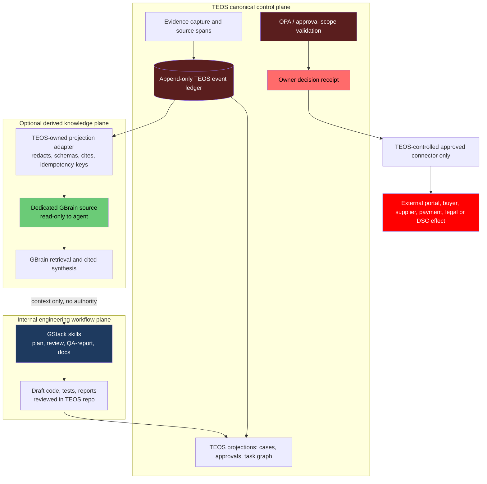

# GStack + GBrain for Governed Tender Export OS

**Assessment date:** 2026-08-10  
**Research boundary:** Official documentation in `garrytan/gstack` and `garrytan/gbrain` only.  
**Implementation status:** Research only. No package, service, credential, MCP registration, browser session, cloud project, remote repository, or other external mutation was performed.

## Decision in one page

**Recommendation: conditional, selective adoption.** Use **GStack** first as an *internal engineering-workflow assistant* for planning, review, testing, documentation, and security analysis of the Tender Export OS (TEOS) codebase. Treat **GBrain** as an optional, segregated *derived retrieval and knowledge-projection layer*. Do **not** make either product the TEOS system of record, approval authority, external-action gateway, or policy enforcement point.

The safe target is:

- **TEOS remains canonical:** event ledger, evidence, case state, approval cards/receipts, policy decisions, and external-effect records stay in TEOS.
- **GBrain is non-canonical:** it may receive a redacted, source-attributed projection of selected completed TEOS facts and artifacts. It may not originate or authorize operational state.
- **GStack is non-authoritative:** it may produce drafts, code changes, tests, and review findings, but cannot call any TEOS external-effect connector or bypass approval checks.
- **Owner remains the only actor for external, money, legal, commercial, portal, signature, classification, origin, delivery, payment, and submission decisions.**

This is a **good architectural fit for internal reasoning and engineering quality**, not a drop-in governance platform. The cited documentation describes useful controls, but it does not establish TEOS-equivalent event ordering, approval-scope validation, or owner-gated external effects. That is the decisive boundary.

---

## 1. Baseline and assessment method

### TEOS baseline used for the assessment

This assessment applies the repository's existing governance contract: TEOS is an event-ledger reference implementation; approval-gated actions stop at an owner decision; external, financial, legal, commercial, portal, and signature effects are owner-controlled. The relevant local operating rules are in `README.md`, `AGENTS.md`, `HERMES.md`, `AGENT_REFERENCE.md`, and `workflows/agent_loop_schedule.md`.

Those local rules are **design constraints**, not evidence about GStack or GBrain. All external-product statements below are cited solely to the two official Garry Tan GitHub repositories.

### How to read claims in this document

| Label | Meaning |
|---|---|
| **Vendor documentation says** | A capability, behavior, or safeguard described by the official repository. It is not independently validated here. |
| **TEOS conclusion** | The adoption decision derived from the documented behavior and TEOS governance requirements. |
| **Required control** | A condition TEOS must impose itself. It must not be delegated to a model prompt, a skill description, or a product default. |

### Evidence limitations

- This is a documentation-based technical assessment, not a source-code audit, penetration test, performance benchmark, or live integration test.
- Product claims such as productivity gains, retrieval quality, fuzz-test results, or production usage remain **vendor claims** unless independently validated in a TEOS-controlled pilot.
- Absence of a feature from the reviewed documentation is not proof that it does not exist. It is a reason not to rely on that feature for a TEOS safety property.

---

## 2. What each product is, and the governed fit

| Product | Vendor documentation says | TEOS conclusion | Allowed initial role | Not an acceptable role |
|---|---|---|---|---|
| **GStack** | A Markdown-skill workflow layer that casts a coding agent as product, engineering, design, QA, security, and release specialists; its documented flow includes planning, code review, browser QA, and shipping a PR.[1] | A strong fit for improving the *software-development loop* around TEOS. It is not a business-operations control plane. | Draft plans, architecture reviews, code review, test design, QA reporting, documentation, threat-model findings. | Approval authority; policy engine; portal operator; release authority for production; external communications or commercial execution engine. |
| **GStack Browser** | GStack uses a persistent Chromium daemon, preserves browser state, and can handle browser cookies; the documentation also describes a remote pairing/tunnel surface and prompt-injection defenses.[3] | Its browser capability is powerful enough to create real external effects if authenticated state exists. It therefore belongs outside the default TEOS workflow. | Local testing of a TEOS staging app with non-production data and no imported portal cookies. | Tender/buyer/supplier portals, payment systems, e-signature/DSC, email, messaging, or any authenticated commercial surface. |
| **GBrain** | A retrieval/memory layer with search, synthesis, graph traversal, source-oriented answers, MCP exposure, and a reduced five-verb interface.[2][14] | A good fit for a **read-only, derived TEOS knowledge projection**: searching prior cases, evidence summaries, runbooks, decisions, and completed retrospectives. | Read-only retrieval, cited synthesis, controlled internal brief preparation. | TEOS event ledger, canonical evidence store, approval register, legal/commercial truth source, or external-action queue. |
| **GStack ↔ GBrain integration** | GStack can automatically load brain context and save planning outputs through `gbrain put`; documented routing notes that `.gbrain-source` pins reads while writes target the default engine.[5] | Direct automatic writeback is incompatible with a governed TEOS boundary until wrapped by a TEOS-owned projection adapter. | Disabled at first; later only a policy-gated, redacted, idempotent projection path. | Direct agent writes from a planning skill into operational TEOS knowledge or any source containing approvals/evidence. |

---

## 3. Core capabilities and constraints

### 3.1 GStack

**Vendor documentation says:** GStack is a set of opinionated Markdown skills around a persistent browser. Its README positions skills for product interrogation, architecture/design review, code review, QA, security review, release, and retrospective work.[1][3]

**TEOS conclusion:** The best value is upstream of operations: use it to improve the TEOS repository, schemas, tests, documentation, and offline simulations. That improves governance without granting new business-action authority.

**Capabilities worth adopting later**

1. **Architecture and plan challenge.** Use the planning/review skills to examine state transitions, idempotency behavior, evidence coverage, approval-card schema changes, and test matrices before TEOS changes land.[1]
2. **Code-review and security-analysis support.** Use findings as inputs to the existing TEOS review/CI process, not as final security sign-off.[1]
3. **QA reporting.** The report-only QA posture is more compatible than auto-fix or release skills because it can discover defects without changing an operational system.[1]
4. **Documentation and diagrams.** GStack’s Markdown-oriented model fits policy documents, runbooks, threat models, and test plans that TEOS can retain as review artifacts.[1][3]

**Material constraints**

- GStack is explicitly designed to drive implementation, browser QA, and release workflows. A documented end-to-end example includes implementation, fixes, browser testing, and a PR. That is useful for software delivery but too broad to be trusted as an operational workflow default.[1]
- GStack team mode can bootstrap repository configuration and describes an automatic update check at session start. TEOS should pin and review versions in a dedicated sandbox rather than allow unreviewed workflow changes in an operational environment.[1]
- GStack’s GBrain guide defines a per-repository `read-write` / `read-only` / `deny` policy triad.[4] TEOS should begin with **deny**, rather than relying on a policy prompt to suppress direct memory writes.
- Its setup skill is a provisioning routine that can install the CLI, initialize a brain, register MCP, and capture a per-remote trust policy.[7] None of those provisioning actions were run for this assessment; they require a separate, owner-approved change request.
- The persistent-browser design intentionally keeps session state. The documentation states cookie import may require a user Keychain approval and that browser state is preserved across commands; this is a high-value capability but also a direct authenticated-action risk.[3]

### 3.2 GBrain

**Vendor documentation says:** GBrain offers raw retrieval and synthesized answers, a graph of typed entity relationships, local and HTTP MCP access, and either a full tool surface or a restricted five-verb surface.[2][14]

**TEOS conclusion:** GBrain can add recall and synthesis over a carefully selected TEOS projection. It should be treated as a *derived knowledge service*, never as the authority that decides whether a fact, approval, or external effect is valid.

**Capabilities worth adopting later**

1. **Cited retrieval and synthesis.** GBrain’s stated design differentiates search from an answer that carries sources and gaps. That maps well to owner briefs and internal research summaries, provided TEOS still verifies every source and does not treat synthesized text as a commitment.[2]
2. **Knowledge grouping and isolation.** GBrain documents separate brains and sources, with explicit source routing. This can support a dedicated TEOS knowledge domain separate from personal, customer, or code-search data.[9]
3. **A small MCP surface.** The five verbs are `recall`, `remember`, `entity`, `synthesize`, and `forget`; the `--surface verbs` mode hides other operations fail-closed at dispatch.[14]
4. **Source-attribution conventions.** Its documentation calls for citations, conflicts to remain visible, and source/date/context on timeline entries. Those are compatible with TEOS evidence discipline, but must be validated against the TEOS ledger rather than copied as truth.[16]

**Material constraints**

- GBrain’s documented system-of-record contract is Git/Markdown plus frontmatter; Postgres/PGLite is a derived cache rebuilt from those files.[8] That is useful for knowledge artifacts, but it is not a substitute for TEOS’s append-only event ledger and approved-effect receipt chain.
- The GBrain recommended schema describes an **event ledger** and fact store as a desired knowledge-base pattern.[12] This is a vendor reference pattern, not evidence that a deployed GBrain instance supplies TEOS-grade immutable event ordering, approval scope hashes, receipt validation, or external-effect prevention. **TEOS must retain those controls.**
- `remember` and `forget` are write operations. The documented default visibility for remembered facts is `world`, meaning every connected agent may read them unless `private` is explicitly used.[14] That default is unsuitable for tender, supplier, buyer, pricing, compliance, and approval information.
- A documented split-engine topology warns that a wrong MCP alias can write or query the wrong brain silently.[13] This makes implicit routing unacceptable for TEOS canonical data.

---

## 4. Recommended architecture

### Non-negotiable authority flow

1. **Evidence enters TEOS first.** Preserve the original source, capture metadata, source span, retrieval time, case reference, and integrity evidence in TEOS.
2. **The TEOS ledger decides history.** All lifecycle changes, draft creation, approval requests, owner decisions, authorized dispatch attempts, and receipts append to the existing canonical ledger.
3. **GBrain receives only a projection.** The TEOS-owned adapter emits a redacted, source-attributed, immutable-reference projection only after deterministic validation. It never imports a GBrain page back as a TEOS event.
4. **GStack receives context, not authority.** It can read bounded, clearly labeled projections and write local drafts/reports. Its output remains untrusted until it passes TEOS validation and human review.
5. **Only TEOS-controlled connectors may effect the outside world.** Those connectors must require a valid owner decision receipt, exact scope/hash, expiry, unused-action state, and the existing policy decision record.

### Data placement matrix

| Data class | Canonical home | GBrain treatment | GStack treatment |
|---|---|---|---|
| Raw portal/source evidence, source spans, captures | TEOS evidence store and ledger | Never copy raw by default. Use an approved redacted excerpt only when necessary. | Read only through a TEOS-generated artifact; never through live portal/browser state. |
| Events, case state, approval cards, owner decisions, policy receipts | TEOS ledger/projections | No direct write and no canonical copy. Optional summarized, post-event projection only. | Context only; cannot create or consume approval authority. |
| Draft research, completed retrospective, code-review finding, non-sensitive runbook | TEOS artifact store | May be mirrored with `case_id`, artifact hash, classification, source pointers, and `derived_from_event_ids`. | May produce a draft; TEOS review records acceptance/rejection. |
| Pricing, legal/compliance analysis, origin/classification candidates | TEOS draft artifact with explicit status | Exclude by default; if mirrored, label `DRAFT_NOT_AUTHORITY`, include expiry and evidence references. | Draft/review only; never a final statement or external communication. |
| Portal cookies, credentials, API keys, owner signatures, DSC material, payment data | Approved TEOS secret boundary only | Never ingest, index, sync, or expose to any brain. | Never import into GStack Browser or prompts. |

---

## 5. Risk boundaries and required controls

| Risk boundary | Vendor documentation says | TEOS risk | Required control |
|---|---|---|---|
| **Implicit GStack writeback** | GStack documents `gbrain put` save paths, and notes that `.gbrain-source` pins reads while writes target the default engine.[5] | A planning skill can persist a report or entity stub to the wrong knowledge destination. | Set the TEOS repo policy to **GBrain deny** during initial adoption. If enabled later, deny direct GStack writeback and permit only the TEOS projection adapter with a dedicated target source. |
| **Cross-machine artifact sync** | GStack can push allowlisted plans, reviews, retrospectives, learnings, and behavioral state to a private Git repository; `off` is the documented default and other modes are opt-in.[6] | Sensitive tender, buyer, supplier, pricing, or approval artifacts may leave the TEOS boundary even if the remote is private. Secret scanning is defense-in-depth, not classification governance. | Keep artifact sync **off** for TEOS. Do not run brain-init/restore flows against TEOS artifacts. Consider a separately sanitized, owner-reviewed research corpus only after a data-classification review. |
| **MCP memory writes and visibility** | `remember` requires provenance but defaults to `world` visibility; write verbs require write scope.[14] | Confidential commercial facts may be readable by other connected agents or silently persisted. | Use a retrieval-only client with no write scope. Expose only a named, dedicated TEOS source. Do not grant `remember`, `forget`, `put_page`, job, admin, or broad federation privileges to the operational agent. |
| **GBrain guardrails are not enforcement** | Guardrail seams are observe-only, provider verdicts cannot block/rewrite behavior, and failures are swallowed (fail-open).[15] | Treating a classifier or injection detector as a TEOS safety gate would permit unsafe content or tool calls on failure. | Keep enforcement in TEOS policy and connector code. At most, use GBrain guardrails as telemetry/shadow signals with an independent audit log. |
| **Wrong-brain / wrong-source routing** | GBrain documents that alias-level routing is manual and that a wrong alias can write to the wrong brain silently.[13] | Case evidence or code artifacts can contaminate a personal/shared brain; later synthesis can mix domains. | Use one dedicated TEOS brain/source or no GBrain at all. Avoid split-engine multi-alias routing in the operational path. Make every projection carry a fixed `source_id` and reject destination mismatch. |
| **Shared Supabase blast radius** | GBrain documents an auto-RLS trigger that enables RLS on every new `public.*` table, including tables created by other applications sharing the project.[10] | A GBrain migration can alter TEOS database behavior or break applications if they share a Supabase project/schema. | **Never share a database, Supabase project, Postgres role, or public schema between GBrain and TEOS.** Use separate infrastructure and least-privilege credentials. |
| **Remote MCP exposure** | GBrain recommends DCR disabled by default, pre-registered trusted clients, operator-approved scopes/source access, loopback binding by default, and scoped tokens.[11] | A remotely exposed brain expands the attack surface and may make commercial context accessible beyond TEOS controls. | Start local-only. If a remote brain is ever justified, require dedicated infrastructure, TLS, no DCR, explicit read-only client/source scope, allowlisted origin/proxy, audit-log review, and an owner-approved threat model. |
| **Authenticated browser side effects** | GStack preserves browser state and documents cookie import, persistent sessions, tunnels, and a localhost security model.[3] | Existing login state can turn a supposedly investigative action into a send, submit, upload, or other external effect. | No portal cookies, no browser-profile import, no paired/tunneled browsing, and no external URLs in the initial rollout. Any future browser evidence capture must be a separate owner-approved TEOS action with a dedicated, non-privileged session. |
| **Provenance decay in synthesized pages** | GBrain’s source-attribution guidance requires every fact and timeline entry to carry source/context/date, and calls for conflicts to remain visible.[16] | Summaries can blur a candidate fact, a draft, an owner decision, and a verified external receipt. | Require TEOS projection fields: `event_id`, `case_id`, `source_uri_or_artifact_hash`, `observed_at`, `confidence`, `status`, `classification`, and `derived=true`. Do not mirror a fact without its source pointer. |
| **Autonomous enrichment and nightly consolidation** | GBrain’s operational discipline explicitly describes signal detection on every message, writes, synchronization, and scheduled consolidation.[17] | Automated capture can write low-confidence conversation fragments into a knowledge base, causing future operational contamination. | Disable autonomous ingestion, message capture, enrichment, and dream-cycle write paths for TEOS. Run only TEOS-scheduled, schema-validated projection jobs after review. |

---

## 6. Explicit vendor-claim assessment

| Vendor documentation claim | Evidence | Assessment conclusion |
|---|---|---|
| GStack can act as a virtual engineering team across planning, review, QA, security, and release.[1] | Official project README. | **Plausible workflow capability, not governance evidence.** Pilot against TEOS code only and measure review quality, test catch rate, and false positives. |
| GStack browser security includes localhost binding, tokens, cookie protections, tunnel restrictions, and prompt-injection layers.[3] | Official architecture document. | **Useful defense-in-depth, insufficient for business-action authorization.** TEOS must still deny access to authenticated external systems unless an owner-approved connector is used. |
| GBrain provides synthesis with sources/gaps and graph traversal.[2] | Official project README. | **Useful retrieval capability, not a verification engine.** A cited GBrain answer is an aid to investigation; TEOS evidence/approval state remains authoritative. |
| GBrain supports small/fail-closed MCP verb exposure and source-scoped permissions.[13][14] | Official topology and protocol docs. | **Promising least-privilege primitives, configuration-sensitive.** Use read-only, isolated service identities and prove denial cases in a TEOS test environment. |
| GBrain describes event-ledger and provenance-aware knowledge patterns.[12][16] | Official schema and attribution guides. | **Conceptually aligned with TEOS.** Do not infer that the product replaces TEOS’s existing event/receipt protocol; use it only as a downstream view. |
| GBrain includes security and RLS hardening documentation.[10][11] | Official security guides. | **Positive engineering signals, not an independent assurance claim.** Separate infrastructure and conduct a TEOS-specific threat model before remote/shared use. |

---

## 7. Phased adoption recommendation

### Phase 0 — Boundary freeze and test design

**Goal:** Make the control contract executable before adding either product.

- Write an integration contract that marks TEOS as canonical and GStack/GBrain as non-authoritative.
- Create deny tests proving that a GStack/GBrain agent cannot call TEOS external-effect tools, alter an approval, mark an event executed, or read secrets.
- Define the data classification and a projection schema with explicit provenance and status fields.
- Create an allow/deny matrix for GStack skills. Initially allow only planning, review, documentation, and report-only QA; deny shipping, deployment, external browsing, cookie import, artifact sync, and direct GBrain writeback.

**Exit gate:** Automated tests prove that missing, expired, mismatched, or already-used approval receipts cannot reach an external connector, regardless of GStack/GBrain output.

### Phase 1 — GStack engineering-only sandbox

**Goal:** Evaluate workflow benefit without business data or external state.

- Run GStack only on a disposable TEOS worktree or non-production branch with synthetic/redacted fixtures.
- Use plan/review/security/documentation/report-only QA tasks.
- Do not use `/ship`, `/land-and-deploy`, browser cookie import, pairing/tunnel features, automatic updates, team bootstrap, artifact sync, or GBrain integration.
- Require conventional TEOS code review and CI before any change is accepted.

**Success measures:** verified defects found, tests added, documentation coverage, review false-positive rate, and no unauthorized file or network changes.

**Exit gate:** The team can show that every accepted GStack output was reviewed through existing TEOS development controls and that no external effect occurred.

### Phase 2 — GBrain read-only retrieval pilot

**Goal:** Test whether curated history improves internal research and owner briefs.

- Create one **dedicated** GBrain instance/source for `teos-derived-retrieval`; do not share TEOS database infrastructure or a personal/shared brain.
- Seed only sanitized, completed, source-attributed artifacts and selected ledger-derived summaries. Do not seed raw evidence, credentials, pending approvals, pricing, legal analyses, or portal data.
- Grant the agent read-only access. Prefer a restricted memory surface and omit all write/admin scopes.
- Compare GBrain output with direct TEOS retrieval for accuracy, source citation coverage, stale-data detection, and cross-case leakage.

**Success measures:** source-level precision, correct `case_id` linkage, conflict disclosure, no leakage across cases/classifications, and measurable owner-brief usefulness.

**Exit gate:** Red-team prompts and automated tests demonstrate no GBrain write path, no cross-source leakage, and no treatment of a synthesized answer as an approval or verified fact.

### Phase 3 — TEOS-owned governed projection adapter

**Goal:** Permit useful freshness without direct agent writeback.

- Implement a TEOS internal adapter, not a GStack skill, that consumes only validated TEOS events/artifacts.
- Require immutable source pointers, event IDs, classification labels, idempotency keys, projection version, and deletion/tombstone handling.
- The adapter writes only to the dedicated GBrain source with a narrowly scoped service identity. GStack remains unable to write to that source.
- Make projection one-way: GBrain can inform a TEOS draft, but no GBrain page may mutate TEOS state without re-validation against the TEOS ledger.

**Success measures:** deterministic replay, idempotency, full provenance, no sensitive fields in the projection, and correct behavior during partial failure/retry.

**Exit gate:** A restore/replay test reconstructs the GBrain projection solely from TEOS artifacts while the TEOS ledger remains unchanged and authoritative.

### Phase 4 — Optional owner-approved browser evidence capture

**Goal:** Consider browser support only after the prior controls are proven.

- Treat this as a new TEOS connector class, not a GStack default capability.
- Require a dedicated, non-privileged browser profile and explicit owner approval scoped to one case, site, purpose, time window, and permitted read/download actions.
- Enforce no-send/no-submit/no-upload/no-payment/no-DSC/no-login-creation constraints in the connector itself.
- Capture the interaction as TEOS evidence and append a ledger event; do not rely on browser history or GStack logs as the receipt of record.

**Exit gate:** The control test suite proves denial for every prohibited action and preserves a TEOS receipt for every allowed read/download.

---

## 8. Permanent no-go boundaries

The following remain outside GStack and GBrain authority even after a successful pilot:

1. Creating, changing, approving, expiring, or consuming a TEOS approval.
2. Sending supplier/buyer communication, an RFQ, a quotation, clarification, reminder, or legal/commercial statement.
3. Submitting a tender/bid, uploading documents, using DSC/e-signature, accepting terms, committing price/delivery, confirming HSN/ITC-HS, or claiming origin.
4. Paying, initiating payment, creating a purchase order, accepting payment terms, or handling financial credentials.
5. Logging into a portal, creating an account, importing browser cookies, or exposing a remote browser without an owner-approved TEOS connector action.
6. Treating a GBrain memory, synthesis, graph edge, or GStack recommendation as proof, an approval, or an external-effect receipt.
7. Storing TEOS secrets, owner decisions, pending approvals, raw portal captures, or protected commercial/legal content in GStack sync, a GBrain brain, prompt text, or remote MCP logs.

---

## 9. Final recommendation

Adopt **GStack first**, narrowly, as an internal code-quality and documentation accelerator. It can improve the TEOS system without touching the TEOS operational boundary.

Adopt **GBrain later**, only if a read-only pilot demonstrates that source-attributed retrieval materially improves owner briefs or internal research. Keep it a segregated, replayable projection with no direct agent write paths.

Do **not** adopt either product as a replacement for the TEOS ledger, OPA/policy checks, approval card/receipt protocol, deterministic projections, or owner-controlled external connectors. Their documented memory, browser, sync, and autonomous-write capabilities are precisely why TEOS must integrate them behind a stricter boundary rather than grant them operational authority.

## Sources

[1] https://github.com/garrytan/gstack/blob/main/README.md
    > "gstack is how I do it."
[2] https://github.com/garrytan/gbrain/blob/master/README.md
    > "GBrain exposes 110 tools over MCP (stdio and HTTP)"
[3] https://github.com/garrytan/gstack/blob/main/ARCHITECTURE.md
    > "gstack gives Claude Code a persistent browser and a set of opinionated workflow skills."
[4] https://github.com/garrytan/gstack/blob/main/USING_GBRAIN_WITH_GSTACK.md
    > "Every repo on your machine gets a policy decision: **read-write**, **read-only**, or **deny**."
[5] https://github.com/garrytan/gstack/blob/main/docs/gbrain-write-surfaces.md
    > "`.gbrain-source` pins **reads** only — writes go to the default engine"
[6] https://github.com/garrytan/gstack/blob/main/docs/gbrain-sync.md
    > "GBrain sync pushes a curated subset to a private git repo so your memory follows you across machines and becomes indexable by GBrain."
[7] https://github.com/garrytan/gstack/blob/main/setup-gbrain/SKILL.md
    > "Set up gbrain for this coding agent: install the CLI, initialize a local PGLite or Supabase brain, register MCP, capture per-remote trust policy."
[8] https://github.com/garrytan/gbrain/blob/master/docs/architecture/system-of-record.md
    > "The GitHub repo (markdown + frontmatter) is the system of record."
[9] https://github.com/garrytan/gbrain/blob/master/docs/architecture/brains-and-sources.md
    > "A brain is a database."
[10] https://github.com/garrytan/gbrain/blob/master/docs/guides/rls-and-you.md
    > "A Postgres DDL event trigger named `auto_rls_on_create_table` runs `ALTER TABLE … ENABLE ROW LEVEL SECURITY` on every newly created `public.*` table."
[11] https://github.com/garrytan/gbrain/blob/master/SECURITY.md
    > "GBrain disables Dynamic Client Registration (DCR) by default."
[12] https://github.com/garrytan/gbrain/blob/master/docs/GBRAIN_RECOMMENDED_SCHEMA.md
    > "Event ledger — every signal that touches the brain is an immutable event:"
[13] https://github.com/garrytan/gbrain/blob/master/docs/architecture/topologies.md
    > "A wrong alias writes (or queries) the wrong brain silently."
[14] https://github.com/garrytan/gbrain/blob/master/docs/protocol/MEMORY_VERBS_v1.md
    > "`remember`/`forget` are write-scope"
[15] https://github.com/garrytan/gbrain/blob/master/docs/guardrails.md
    > "Observe-only. `runGuardrails()` returns `void`."
[16] https://github.com/garrytan/gbrain/blob/master/docs/guides/source-attribution.md
    > "Every fact in the brain traces to where it came from -- who said it, in what context, and when."
[17] https://github.com/garrytan/gbrain/blob/master/docs/guides/operational-disciplines.md
    > "Signal Detection on Every Message (MANDATORY)"
